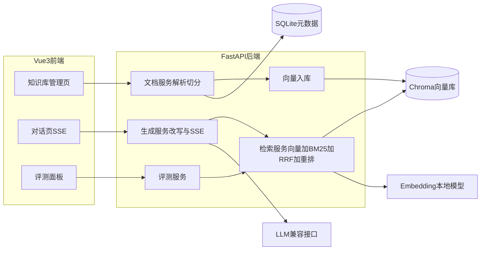

# PRD：企业内部知识库智能问答系统（RAG）

> 版本：v1.1 ｜ 日期：2026-11-06 ｜ 状态：待开发  
> 本文档面向 AI 编码工具（Cursor / Claude Code 等）。需求均编号化、可验收。生成代码时严格按第 9 节里程碑顺序实现，不要一次生成全部代码。

v1.1 相对 v1.0 的变更：删除文档中的密钥；锁定模型、拒答阈值和检索口径；检索前改写纳入 M2；写明异步入库、SSE、停止与重新生成；补齐评测命中规则，并附 `docs/sample-corpus/` 示例语料。

---

## 1. 项目概述

### 1.1 背景

企业内部文档（操作手册、制度规范、技术文档）分散存储，员工查找信息效率低。传统关键词搜索无法理解语义，且无法直接给出答案。本项目基于 RAG（Retrieval-Augmented Generation，检索增强生成）技术构建企业内部知识库智能问答系统：用户用自然语言提问，系统从知识库中检索最相关的文档片段，由大语言模型基于片段生成带引用溯源的回答。

### 1.2 项目目标

1. 实现完整的 RAG 链路：文档上传 → 解析切分 → 向量化入库 → 混合检索 → 引用溯源问答 → 评测验证。
2. 所有回答必须可溯源：每条回答附引用的原文片段，可定位回源文档的抽取文本。
3. 本地可一键跑通（两条命令分别启动前后端），面试现场可演示。不上传私有 PDF 时，可用 `docs/sample-corpus/` 完成演示和评测验收。

### 1.3 简历叙事定位

- **AI 应用开发工程师方向**：讲 RAG 全链路工程能力——切分策略调优、混合检索、评测驱动迭代、SSE 流式架构、成本与容错设计。
- **AI 前端工程师方向**：讲复杂 AI 交互体验——SSE 流式渲染、引用溯源高亮定位、Markdown/代码块流式解析、乐观更新与中断重试。

### 1.4 范围外（本版本不实现）

- 用户登录鉴权与多租户权限隔离（架构上不把用户 id 写死进表结构以外的地方，表可以没有 user_id）
- 文档在线协同编辑
- 高并发、分布式部署、消息队列、Alembic 迁移
- OCR 与扫描件识别
- PDF 坐标框高亮和内嵌 PDF 阅读器
- 文档处理的分阶段进度条（解析中 / 切分中 / 向量化中）
- 独立的第二套评测向量库
- 用大模型自动给答案打分（评测只做检索与拒答门控）

---

## 2. 用户角色与核心场景

| 角色    | 描述      | 核心场景                                       |
| ----- | ------- | ------------------------------------------ |
| 知识管理员 | 维护知识库内容 | 上传 PDF/Word/Markdown 文档；查看文档处理状态；删除文档；重建索引 |
| 普通用户  | 知识库使用者  | 自然语言提问；获得带引用溯源的流式回答；查看历史会话；继续追问            |

**核心场景示例**：用户上传《检验科-ALT检测与样本处理.md》后提问「ALT 异常升高时样本应如何处理？」，系统流式输出回答，回答下方展示引用卡片（含来源文档名与页码/章节）。点击引用，打开抽取文本抽屉，整段 chunk 高亮，并显示文档名、页码、章节。

示例语料是虚构制度，只用于演示和评测，不作为真实医疗建议。

---

## 3. 功能需求

优先级定义：P0 = MVP 必须；P1 = 亮点功能；不做 = 本版本不实现。

### 3.1 文档管理模块

| 编号   | 需求      | 说明                                                                                                | 优先级 |
| ---- | ------- | ------------------------------------------------------------------------------------------------- | --- |
| F1-1 | 文档上传    | 支持 .pdf / .docx / .md / .txt，单文件 ≤ 20MB，拖拽或点选上传。扩展名不区分大小写                                              | P0  |
| F1-2 | 文档解析    | PDF 用文本层抽取（pypdf）；DOCX 按段落抽取（python-docx）；MD/TXT 按 UTF-8 读取，失败再试 GBK。页码、章节规则见 5.4                         | P0  |
| F1-3 | 文本切分    | 递归字符切分，分隔符顺序为 `\n\n`、`\n`、`。`、`！`、`？`、`；`。默认 chunk_size=500 字符，overlap=50。保留与源文档的关联及位置信息             | P0  |
| F1-4 | 向量化入库   | 调用 Embedding 模型将 chunk 向量化，写入 Chroma 集合 `kb_chunks`，携带 metadata（文档 ID、文档名、chunk 序号、页码、章节）              | P0  |
| F1-5 | 文档列表    | 展示文档名、类型、大小、chunk 数量、处理状态（处理中/就绪/失败）、上传时间。失败文档用 tooltip 展示 error_msg。有处理中文档时每 2 秒轮询一次列表              | P0  |
| F1-6 | 删除文档    | 删除文档记录、全部 chunk、Chroma 中该文档向量、磁盘文件，并重建内存 BM25。前端二次确认                                                 | P0  |
| F1-7 | 重建索引    | 对单个文档或全部就绪文档重新切分并向量化。删除旧 chunk 与旧向量后再写入。用于调整切分参数                                               | P1  |
| F1-8 | 处理进度可视化 | 分阶段进度条                                                                                            | 不做  |

**处理时序**（同时满足「损坏文件返回 422」和「列表里能看到处理中」）：

1. `POST /documents` 同步检查扩展名、大小、空文件。PDF 文件头必须是 `%PDF`，DOCX 文件头必须是 `PK`。文件打不开、无法解码、扩展名不对：HTTP 422，不创建文档记录，前端 toast 显示 `message`。
2. 同步抽出文本。抽出文本去空白后为空（含扫描件）：创建文档，`status=failed`，`error_msg` 写明「未抽出文本，当前只支持文本型 PDF」。
3. 文本非空：保存文件，`status=processing`，HTTP 201 立刻返回文档对象。FastAPI `BackgroundTasks` 在同一进程内做切分、向量化、入库，完成后改为 `ready`。任一步失败则改为 `failed`，删掉已写入的半成品 chunk 和向量，`error_msg` 为中文原因。
4. 服务启动时，把仍为 `processing` 的文档改为 `failed`，`error_msg` 为「服务重启，请删除后重新上传或重建索引」。

**验收标准**：

- F1-1～4：上传一份约 10 页的文本型 PDF，或上传 `docs/sample-corpus/` 中的任一 Markdown，2 分钟内状态变为「就绪」，Chroma 中能按 `document_id` 查到对应 chunk。
- F1-2：上传损坏的 PDF（打不开）时返回 HTTP 422 及中文 `message`，前端有错误提示，文档列表不出现该文件。
- F1-2：上传无文本层的 PDF 时，列表中该文档状态为「失败」，tooltip 说明只支持文本型 PDF。
- F1-6：删除后，SQLite、Chroma、磁盘文件中该文档数据全部清除，之后的问答不再引用它。

### 3.2 智能问答模块

| 编号   | 需求        | 说明                                                                                          | 优先级 |
| ---- | --------- | ------------------------------------------------------------------------------------------- | --- |
| F2-1 | 检索 Top-K  | 对检索问句做向量化，召回相关 chunk。纯向量模式下直接取 Top-K（默认 K=5）。混合检索与重排的召回宽度见 F5                                 | P0  |
| F2-2 | 引用溯源回答    | 提示词约束模型只依据检索片段作答。回答为 Markdown，关键结论用 `[n]` 标注。引用列表含片段原文、来源文档名、页码、章节、分数、展示编号                  | P0  |
| F2-3 | 流式输出      | `POST .../chat` 用 SSE 推送正文。前端用 `fetch` 读取流并渲染 Markdown。M1 另提供非流式 `chat/complete`，M2 之后保留     | P0  |
| F2-4 | 多轮对话      | 生成时携带最近 N 轮历史（默认 5 轮，只含角色和正文，助手正文截断到 500 字）。刷新后会话仍在                                          | P0  |
| F2-5 | 拒答兜底      | 无召回，或分数低于第 5.5 节阈值时，不调用生成模型，固定回复「知识库中未找到相关信息」，引用列表为空                                       | P0  |
| F2-6 | 引用高亮定位    | 点击引用卡片，抽屉展示该 chunk 的抽取全文，整段高亮，并显示文档名、页码、章节。数据来自 `GET /documents/{id}/chunks/{chunk_id}`      | P1  |
| F2-7 | 回答中断与重新生成 | 生成中可停止 SSE。停止后保存已生成的半截内容，`status=stopped`。可对同一条助手消息重新检索并生成                                     | P1  |
| F2-8 | Query 改写  | M2 起，检索前调用同一 LLM，把当前问题改写成可独立检索的问句。改写失败或超时则用原问题继续检索。生成阶段仍使用原始问题和历史。M1 不做改写，直接用原问题检索 | P0  |

**验收标准**：

- F2-2/3：提问后首 token 出现时间 < 3 秒（本地、Embedding 已加载完成、无历史因此不触发改写）；带历史的多轮问题多一次改写调用，首 token < 6 秒。答案流式渲染，知识库内问题在末尾或正文中能对应到至少 1 条引用。
- F2-5：提问「今天天气怎么样」，系统回复「知识库中未找到相关信息」，引用列表为空，且该次不调用生成模型。
- F2-4：在已入库示例语料上，先问「ALT 是什么」，再问「它的正常值范围是多少」。第二问送去检索的问句必须包含「ALT」，回答给出成人参考区间 7～40 U/L。

### 3.3 会话管理模块

| 编号   | 需求   | 说明                                                          | 优先级 |
| ---- | ---- | ----------------------------------------------------------- | --- |
| F3-1 | 会话列表 | 按 `updated_at` 倒序。标题取首条用户问题的前 20 个字符；没有消息时标题为「新会话」。支持删除      | P0  |
| F3-2 | 消息历史 | 每条消息含：角色、内容、引用列表、时间戳、Token 用量、status（completed / stopped / error） | P0  |
| F3-3 | 新建会话 | 一键新建空白会话。进入对话页时如果一条会话都没有，自动新建一条                               | P0  |

**验收标准**：刷新页面后会话与消息完整恢复。消息上的 Token 数等于该轮改写与生成的用量之和。

### 3.4 评测模块（简历亮点）

| 编号   | 需求     | 说明                                                                                         | 优先级 |
| ---- | ------ | ------------------------------------------------------------------------------------------ | --- |
| F4-1 | 评测集管理  | 用例文件为 `docs/sample-corpus/cases.json`。实现时复制到 `backend/evals/cases.json` 并按该路径加载。共 20 条：14 条直接可答、4 条模糊或跨文档、2 条超纲拒答 | P1  |
| F4-2 | 检索评测   | 只做检索和拒答门控，不调用生成模型。answerable 计算 Recall@K 与 MRR；refusal 单独计算拒答率。答案要点只展示，不自动打分。判定规则见 7.4     | P1  |
| F4-3 | 评测报告面板 | 展示指标、逐条通过情况，并可与一次历史运行对比差值。修改切分参数再运行时，先重建当前知识库全部就绪文档的索引，面板必须先确认「将重建当前知识库索引」                   | P1  |

**验收标准**：示例语料全部入库后，默认参数（chunk_size=500、overlap=50、use_hybrid=true、use_rerank=false、K=5）下，18 条 answerable 的 Recall@5 ≥ 0.8。再改一次 chunk_size 重跑后，面板能并排看到两次的 Recall@5 与 MRR。

### 3.5 检索增强模块（简历亮点）

| 编号   | 需求        | 说明                                                                                          | 优先级 |
| ---- | --------- | ------------------------------------------------------------------------------------------- | --- |
| F5-1 | 混合检索      | `USE_HYBRID=true` 时，向量与 BM25 各取 `RECALL_K`（默认 20），用 RRF 融合，常数 `RRF_K=60`。中文分词用 jieba 搜索引擎模式 | P1  |
| F5-2 | 重排 rerank | `RERANK_ENABLED=true` 时，对融合后的前 20 条调用 Cohere `rerank-v3.5`，取 Top-K 进入生成                        | P1  |
| F5-3 | 策略开关      | `USE_HYBRID`、`RERANK_ENABLED` 来自环境变量。评测接口可以用请求体覆盖这一次运行的策略，不改写环境变量                               | P1  |

**验收标准**：在同一份示例语料上，混合检索相对纯向量的 Recall@5 或 MRR 至少有一项更高，评测面板能看到两次运行的数字。rerank 关闭时系统仍可完成问答和评测。开启 rerank 后，指标不低于关闭时的记录；若 Cohere 不可用，运行结果标为失败并给出中文原因，已有索引保持不变。

M1 只实现纯向量。M1 读到 `USE_HYBRID=true` 时仍走纯向量，不报错。M3 起这两个开关生效。

---

## 4. 非功能需求

| 编号 | 需求    | 说明                                                                                                             |
| -- | ----- | -------------------------------------------------------------------------------------------------------------- |
| N1 | 超时与重试 | 外部调用设置超时：LLM 连接 10 秒、单次生成总时长 120 秒；Embedding 30 秒；Rerank 30 秒；Query 改写 15 秒。网络错误、429、5xx 重试 2 次，指数退避加随机抖动。4xx 配置错误（如 Key 无效）不重试。重试仍失败时，流式接口推 `error` 事件，非流式接口返回 502 或 504，`message` 为中文 |
| N2 | 凭据安全  | API Key 只从环境变量读取。禁止硬编码，禁止写入日志、前端包和接口响应。仓库只提交 `.env.example`，`.env` 加入 gitignore                                      |
| N3 | 成本统计  | 改写与生成的 prompt/completion token 相加后写入该轮助手消息。Embedding 无 token 回执时只计调用次数。`GET /usage/daily` 返回近 7 个 UTC 日，缺日补 0 |
| N4 | 错误处理  | 成功体为 `{code:0, data, message:"ok"}`。失败体为 `{code, message, detail}`，`message` 给用户看，`detail` 给排查用。分类：可重试（网络、429、5xx）、需人工（Key 或基地址错误）、终止（参数非法、文件不合法） |
| N5 | 输入校验  | 上传校验扩展名与大小。问题去掉首尾空白后不能为空，长度 ≤ 2000 个字符（按 Unicode 码位计）                                                              |
| N6 | 日志    | 每个请求有 `trace_id`（请求头 `X-Trace-Id`，没有则生成 UUID），并在响应头回传。日志一行一个 JSON，字段含 `trace_id`、`path`、`method`、`status_code`、`duration_ms`。问答日志可加 `question_length`。禁止记录问题全文、文档正文、Authorization 和 API Key |

HTTP 状态与 `code` 的对应：

| HTTP | code | 场景                          |
| ---- | ---- | --------------------------- |
| 200  | 0    | 查询、删除、停止成功                  |
| 201  | 0    | 创建文档或会话成功                   |
| 400  | 400  | 参数非法、空问题、超长、对处理中的文档重建索引     |
| 404  | 404  | 文档、会话、消息、chunk 不存在          |
| 422  | 422  | 文件打不开、类型不对、文本无法解码           |
| 502  | 502  | 上游返回错误且重试耗尽                 |
| 504  | 504  | 上游超时且重试耗尽                   |

---

## 5. 技术架构

### 5.1 架构图



### 5.2 技术选型

以下选型已锁定。实现时只去 PyPI 核对依赖的当前稳定版本，不更换模型名。

| 层         | 选型 | 说明 |
| --------- | --- | --- |
| 前端        | Vue 3 + Vite + TypeScript + Pinia + Vue Router + Element Plus | 流式渲染自行封装。Markdown 用 markdown-it，`html: false`。代码高亮用 highlight.js |
| 后端        | Python 3.11+ / FastAPI + Uvicorn | SSE 用 `StreamingResponse`。启动时 `create_all`，不用 Alembic |
| 文档解析      | pypdf、python-docx、原生读取 MD/TXT | 版本在实现时查 PyPI 后写入 `requirements.txt` |
| 向量库       | Chroma 持久化到 `CHROMA_DIR` | 集合名 `kb_chunks`，空间 `cosine` |
| 元数据存储     | SQLite + SQLAlchemy 2 | 文档、chunk、会话、消息、评测运行 |
| Embedding | 默认 `BAAI/bge-small-zh-v1.5`，`EMBEDDING_BACKEND=fastembed`（ONNX，不依赖 torch），`device=cpu` | 向量归一化，512 维。查询加前缀，入库文本不加。模型缓存在 `backend/storage/models`。可选后端 `sentence-transformers`（安装 `requirements-torch.txt`）。默认用小模型，是为了在 CPU 上满足首 token 3 秒 |
| LLM       | OpenAI Python SDK，`base_url` 为百炼兼容地址，`model=kimi-k3` | Key 只来自 `LLM_API_KEY`。地址见 5.6。流式开启 `stream_options.include_usage`。请求带 `extra_body={"enable_thinking": false}`。上游返回「Parameter 'x' is not supported」类 400 时（kimi-k3 实测不接受 `temperature`），去掉该参数重试并记住，后续不再发送。只把 `content` 推给前端 |
| BM25      | rank-bm25 的 `BM25Okapi` | jieba `cut_for_search`。进程启动以及入库、删除、重建完成后，用全部就绪 chunk 重建内存索引 |
| rerank    | Cohere `rerank-v3.5`，`POST {RERANK_BASE_URL}` | 默认 `https://api.cohere.com/v2/rerank`。Key 只来自 `COHERE_API_KEY`。默认关闭 |

### 5.3 目录结构

代码放在仓库根目录，不再套一层 `rag-kb/`。

```
backend/
├── app/
│   ├── main.py             # FastAPI 入口、CORS、trace_id、建表
│   ├── config.py           # 读取 .env
│   ├── routers/            # documents / chat / conversations / evals / usage
│   ├── services/           # parser / chunker / embedding / retriever / generator / evaluator
│   ├── models/             # SQLAlchemy 模型
│   └── schemas/            # Pydantic 模型
├── storage/                # 上传文件、Chroma、SQLite（gitignore）
├── evals/
│   ├── cases.json          # 从 docs/sample-corpus/cases.json 复制
│   └── corpus/             # 从 docs/sample-corpus/*.md 复制
├── requirements.txt
├── requirements-torch.txt  # 可选 sentence-transformers 后端
└── .env.example
frontend/
├── src/
│   ├── views/              # KnowledgeBase / Chat / EvalPanel
│   ├── stores/             # Pinia：documents、chat、eval
│   ├── api/                # HTTP 与 SSE 客户端
│   ├── router/
│   └── components/         # MessageBubble / CitationCard / DocUploader / CitationDrawer
├── package.json
└── vite.config.ts
docs/
├── PRD-RAG知识库系统.md
└── sample-corpus/
```

### 5.4 解析、切分与入库

- 主键一律 UUID 字符串。时间一律 UTC，接口里用带 `Z` 的 ISO8601。
- PDF：`page_no` 为 1 起始页码，按页抽取后再拼成全文；`section` 为空字符串。字符偏移按拼接后的全文计算。
- DOCX：按段落用换行拼成全文；`page_no` 为空，`section` 为空字符串。
- Markdown：按标题维护标题路径，写入该段的 `section`（例如 `ALT 是什么`）；`page_no` 为空。
- TXT：整篇为全文；`page_no` 与 `section` 为空。
- 切分后的 chunk 必须记录 `seq`、`content`、`char_start`、`char_end`、`page_no`、`section`。`vector_id` 与 chunk 的 UUID 相同。
- Chroma metadata：`document_id`、`document_name`、`chunk_id`、`seq`、`page_no`（无页码时省略或写空）、`section`。document 字段存 chunk 正文。
- Embedding 批大小 32。查询文本前面加上 `EMBEDDING_QUERY_INSTRUCTION`，入库文本不加。
- 接口不返回 `storage_path`。

### 5.5 检索、融合与拒答

1. 用改写后的问句做检索。M1 没有改写，直接用原问题。
2. 向量检索取 `RECALL_K` 条。余弦相似度 `= 1 - chroma_distance`，小于 0 按 0、大于 1 按 1。
3. `USE_HYBRID=false`：候选就是这 `RECALL_K` 条，按余弦降序。
4. `USE_HYBRID=true`：BM25 另取 `RECALL_K` 条。RRF 分数为各路 `1 / (RRF_K + rank)` 之和，`rank` 从 1 开始。只在一路出现的文档也参与融合。
5. BM25 独有的 chunk，用其已入库向量与问题向量补算余弦，供拒答门控使用。
6. `RERANK_ENABLED=true`：把融合结果的前 20 条送给 Cohere，`top_n = TOP_K`。排序和展示分用返回的 `relevance_score`。
7. `RERANK_ENABLED=false`：从候选中取前 `TOP_K`。展示分用余弦相似度。
8. 拒答门控在调用生成模型之前执行：
   - 候选为空：拒答。
   - 开了 rerank：Top-1 的 `relevance_score` < `RERANK_THRESHOLD`（默认 0.2）则拒答。
   - 没开 rerank：候选里最高余弦 < `VECTOR_THRESHOLD`（默认 0.40）则拒答。该值按示例语料校准：bge-small-zh 上无关问题最高约 0.36，可答问题最低约 0.44。
9. 拒答时不调用生成模型。流式接口不发送 `citations`，`delta` 的正文固定为「知识库中未找到相关信息」。
10. 通过门控后才把 Top-K 片段送给模型，并先发送 `citations`。

RRF 分不参与阈值比较。

### 5.6 运行与环境变量

两条启动命令，各自一个终端：

```bash
cd backend && uvicorn app.main:app --reload --port 8000
cd frontend && npm run dev
```

前端开发服务器端口 5173。Vite 把 `/api` 代理到 `http://127.0.0.1:8000`。

`backend/.env.example` 只放键名和占位值，内容如下。真实 Key 由使用的人自己写进 `backend/.env`，不要写进文档、代码和提交记录。

```bash
LLM_BASE_URL=https://llm-dinftn7ztwksq2qd.cn-beijing.maas.aliyuncs.com/compatible-mode/v1
LLM_API_KEY=
LLM_MODEL=kimi-k3

EMBEDDING_MODEL=BAAI/bge-small-zh-v1.5
EMBEDDING_BACKEND=fastembed
EMBEDDING_DEVICE=cpu
EMBEDDING_QUERY_INSTRUCTION=为这个句子生成表示以用于检索相关文章：

COHERE_API_KEY=
RERANK_MODEL=rerank-v3.5
RERANK_BASE_URL=https://api.cohere.com/v2/rerank
RERANK_ENABLED=false
RERANK_EVAL_INTERVAL=6.5

CHROMA_DIR=storage/chroma
SQLITE_URL=sqlite:///storage/app.db
UPLOAD_DIR=storage/uploads

CHUNK_SIZE=500
CHUNK_OVERLAP=50
TOP_K=5
RECALL_K=20
RRF_K=60
VECTOR_THRESHOLD=0.40
RERANK_THRESHOLD=0.2
HISTORY_ROUNDS=5
USE_HYBRID=true

CORS_ORIGINS=http://localhost:5173
```

`GET /api/health` 返回 `{code:0, data:{status:"ok"}, message:"ok"}`。

---

## 6. 数据模型

```sql
documents(
  id PK,                  -- UUID
  filename,
  file_type,              -- pdf | docx | md | txt
  file_size,              -- 字节
  storage_path,           -- 仅库存，接口不返回
  status,                 -- processing | ready | failed
  chunk_count,
  chunk_size,
  chunk_overlap,
  error_msg,
  created_at              -- UTC
)

chunks(
  id PK,                  -- UUID，同时作为 Chroma id
  document_id FK,
  seq,                    -- 从 0 开始
  content,
  char_start,
  char_end,
  page_no,                -- 可空
  section,                -- 可空字符串
  vector_id
)

conversations(
  id PK,
  title,
  created_at,
  updated_at
)

messages(
  id PK,
  conversation_id FK,
  role,                   -- user | assistant
  content,
  citations JSON,         -- 用户消息为空数组
  prompt_tokens,
  completion_tokens,
  status,                 -- completed | stopped | error
  created_at
)

eval_runs(
  id PK,
  config JSON,            -- chunk_size, chunk_overlap, use_hybrid, use_rerank, k
  recall_at_k REAL,       -- 只统计 answerable
  mrr REAL,
  refusal_rate REAL,      -- 只统计 refusal
  case_count INT,         -- 全部用例数
  detail JSON,
  created_at
)
```

`citations` 元素：

```json
{
  "index": 1,
  "chunk_id": "uuid",
  "document_id": "uuid",
  "document_name": "检验科-ALT检测与样本处理.md",
  "content": "片段原文",
  "page_no": null,
  "section": "ALT 升高后的复检",
  "score": 0.82
}
```

`index` 与回答里的 `[n]` 一致，从 1 开始。`chunks.document_id`、`messages.conversation_id` 建索引。

---

## 7. API 设计

所有接口前缀 `/api`。成功时 `code` 为 0。下面的路径省略前缀。

### 7.1 文档管理

| 方法     | 路径                           | 入参                                      | 出参 |
| ------ | ---------------------------- | --------------------------------------- | --- |
| POST   | /documents                   | multipart：`file`                        | 201，文档对象。损坏文件为 422 |
| GET    | /documents                   | `page` 默认 1，`page_size` 默认 20           | `{items, total, page, page_size}` |
| GET    | /documents/{id}              | -                                       | 文档对象，不含正文 |
| GET    | /documents/{id}/chunks/{chunk_id} | -                                  | chunk 对象：content、page_no、section、seq、char_start、char_end、document_name |
| DELETE | /documents/{id}              | -                                       | `{deleted: true}` |
| POST   | /documents/{id}/reindex      | `{chunk_size?, chunk_overlap?}`         | 文档对象，`status=processing`。处理中返回 400 |

文档对象字段：`id, filename, file_type, file_size, status, chunk_count, chunk_size, chunk_overlap, error_msg, created_at`。

### 7.2 会话与问答

| 方法     | 路径                             | 入参 | 出参 |
| ------ | ------------------------------ | --- | --- |
| GET    | /conversations                 | -   | 会话数组，按更新时间倒序 |
| POST   | /conversations                 | -   | 201，新会话，标题「新会话」 |
| DELETE | /conversations/{id}            | -   | `{deleted: true}`，同时删除其消息 |
| GET    | /conversations/{id}/messages   | -   | 消息数组，按创建时间正序 |
| POST   | /conversations/{id}/chat/complete | `{question}` | 非流式。M1 必须有，之后保留。见 7.3 |
| POST   | /conversations/{id}/chat       | `{question}` | SSE。M2 起必须有 |
| POST   | /conversations/{id}/stop       | `{message_id}` | `{stopped: true/false}`。M3 |
| POST   | /conversations/{id}/regenerate | `{message_id}` | SSE。M3 |

会话对象：`{id, title, created_at, updated_at}`。

消息对象：`{id, conversation_id, role, content, citations, prompt_tokens, completion_tokens, status, created_at}`。

**落库顺序**：

1. 写入用户消息，`status=completed`。首条用户消息写入后，把会话标题设为问题前 20 字。
2. 生成开始前就确定助手消息 UUID。流式响应头返回 `X-Assistant-Message-Id`。
3. 正常结束：写入助手消息，`status=completed`。
4. 用户停止或客户端断开：把已经生成的文本写入助手消息，`status=stopped`。
5. 生成过程出错：写入已有文本，`status=error`。
6. 门控拒答：写入固定拒答句，引用为 `[]`，token 只含改写用量，`status=completed`。

**停止**：内存里用 `message_id` 对应一个取消标记。生成循环每产出一段就检查一次。`message_id` 必须等于响应头里的助手消息 id。生成已经结束时返回 200 且 `stopped=false`。

**重新生成**：`message_id` 必须是助手消息，否则 400。删除该助手消息及其后面的消息，用它前面的那条用户消息作为问题，重新改写、检索、生成，返回 SSE。新的助手消息使用新的 UUID，并通过响应头返回。

### 7.3 非流式与 SSE

`POST /conversations/{id}/chat/complete` 的 `data`：

```json
{
  "message_id": "uuid",
  "content": "回答正文",
  "citations": [],
  "prompt_tokens": 0,
  "completion_tokens": 0,
  "status": "completed"
}
```

`POST /conversations/{id}/chat` 的响应头至少包括：

- `Content-Type: text/event-stream`
- `Cache-Control: no-cache`
- `X-Accel-Buffering: no`
- `X-Assistant-Message-Id: <uuid>`

事件只有下面四种，顺序为：通过门控时先 `citations`，再多次 `delta`，最后 `done`。拒答时没有 `citations`。任一步失败则发送 `error` 并结束。

```
event: citations   data: {"citations": []}
event: delta       data: {"content": "部分文本"}
event: done        data: {"message_id": "", "prompt_tokens": 0, "completion_tokens": 0, "status": "completed"}
event: error       data: {"code": 502, "message": "模型暂时不可用，请稍后重试"}
```

`delta.content` 是增量，不是累计全文。前端自行拼接。生成温度 0.2，最大输出 token 1024。改写温度 0。

### 7.4 评测

| 方法   | 路径          | 入参 | 出参 |
| ---- | ----------- | --- | --- |
| GET  | /evals/cases | -   | `cases.json` 的内容 |
| POST | /evals/run  | `{chunk_size?, chunk_overlap?, use_hybrid?, use_rerank?, k?}` | 一条 eval_run。没有就绪文档时 400 |
| GET  | /evals/runs | -   | 历史运行，按创建时间倒序 |

请求体里的策略只作用于这一次运行。未传的字段用环境变量默认值，`k` 默认 `TOP_K`。

若请求里的 `chunk_size` 或 `chunk_overlap` 与任一就绪文档已保存的切分参数不同：先用这组参数重建**全部就绪文档**，再计算指标。重建覆盖当前 Chroma 集合。前端在发请求前用确认框说明这一点。

**用例字段**：

```json
{
  "id": "C01",
  "type": "answerable",
  "question": "ALT 是什么？",
  "answer_points": ["ALT 是丙氨酸氨基转移酶"],
  "expects": [
    {"document": "ALT检测", "keywords": ["丙氨酸氨基转移酶", "肝细胞"]}
  ]
}
```

`type=refusal` 时 `expects` 为空数组。

**命中规则**：

- 一个 expect 组命中：Top-K 里存在一个 chunk，其文档文件名包含 `document`，且 `content` 同时包含该组全部 `keywords`（按子串、区分大小写）。
- answerable 用例通过：每一个 expect 组都命中。
- 单组用例的 `rank` 是首个命中 chunk 的名次，从 1 开始。多组用例的 `rank` 是各组首个命中名次里的最大值，也就是所有组都齐的那个位置。
- 未通过的 answerable 用例 `rank=0`。
- `Recall@K = 通过的 answerable 数 / answerable 总数`。
- `MRR = answerable 用例的倒数排名平均值`，`rank=0` 的贡献为 0。
- refusal 用例通过：门控判定为拒答（无候选，或分数低于对应阈值）。
- `refusal_rate = 通过的 refusal 数 / refusal 总数`。refusal 不进入 Recall 和 MRR。

`detail` 为数组，元素含 `id, type, hit, rank, matched_chunk_ids`。答案要点原样带回给前端展示。

### 7.5 用量

`GET /usage/daily` 的 `data`：

```json
{
  "days": [
    {"date": "2026-11-06", "prompt_tokens": 0, "completion_tokens": 0, "llm_calls": 0, "embedding_calls": 0}
  ]
}
```

返回最近 7 个 UTC 日期，含当天，没有记录的日期补 0。对话页只在单条消息上展示 token。近 7 日合计放在评测页底部。

### 7.6 提示词

系统提示词：

```
你是企业内部知识库问答助手。你只能依据用户消息中的「检索片段」回答问题。

规则：
1. 片段没有足够依据时，只回答「知识库中未找到相关信息」，不要补充片段以外的知识，不要编造。
2. 使用 Markdown 回答。每条关键结论末尾用半角方括号标出片段编号，例如 [1]。编号必须来自给定片段。
3. 不要输出思维过程，不要复述本规则。
```

改写提示词：

```
你是检索查询改写器。根据对话历史，把「最新问题」改写成一个可以单独用于搜索的中文问句。
要求：
1. 消解「它」「这个」「上述」等指代。
2. 只输出改写后的问句本身，不要加引号或解释。
3. 如果最新问题已经完整，原样输出。
```

改写用户消息包含最近 N 轮的「问：」「答：」以及一行「最新问题：{question}」。助手历史超过 500 字时截断。

送给生成模型的当前用户消息：

```
原始问题：{question}
检索问句：{rewritten}

检索片段：
[1] 来源：{document_name} | 页码：{page_no 或 无} | 章节：{section 或 无}
{content}
```

历史消息只放角色和正文，不放引用 JSON。当前这一轮的原始问题放在上面的用户消息里，不重复追加一条。

---

## 8. 页面设计

路由：

| 路径          | 页面   |
| ----------- | ---- |
| `/`         | 重定向到 `/chat` |
| `/knowledge`| 知识库  |
| `/chat`     | 对话   |
| `/eval`     | 评测   |

顶栏三个入口：知识库、对话、评测。对话页左侧会话栏宽 260px。

### 8.1 知识库管理页

- 顶部上传区：拖拽和点选。不合规的类型或超过 20MB，在请求发出前用文案拦住。
- 表格列：名称、类型、大小、chunk 数、状态、上传时间、操作。
- 操作为删除和重建索引。删除有二次确认。失败状态的 tooltip 显示 `error_msg`。
- 无文档时表格为空状态，提示上传。
- 存在 `processing` 文档时，每 2 秒刷新列表，全部离开该状态后停止轮询。

### 8.2 对话页

- 左侧：会话列表和新建按钮。删除会话前确认。
- 主区：用户消息右对齐，助手消息左对齐。助手消息用 markdown-it 渲染，代码块用 highlight.js。渲染时关闭原始 HTML。
- 引用区：助手消息下方展示引用卡片（文档名、片段摘要、分数）。点击后打开抽屉，高亮整段 chunk，并显示文档名、页码、章节。
- 输入区：多行输入。生成中主按钮变为停止，输入框禁止再次发送，正文末尾有光标动画。
- 用户消息在请求返回前就出现在列表里。请求本身失败时，这条消息标为失败，并提供重试。
- 助手消息角标显示 token 用量。`stopped` 和 `error` 时提供重新生成。
- 没有消息时显示简短引导：先在知识库上传文档，再开始提问。
- SSE 使用 `fetch` + `ReadableStream` 解析 `event:` / `data:`，因为接口是 POST。停止时把响应头里的助手消息 id 传给 stop 接口。

### 8.3 评测面板页

- 参数：chunk_size、overlap、混合检索开关、rerank 开关。
- 「运行评测」在切分参数与当前索引不一致时，先弹出确认：「将按新的切分参数重建当前知识库索引，现有向量会被覆盖。」
- 结果区：Recall@5、MRR、拒答率三张指标卡；逐条用例表（编号、类型、问题、是否通过、rank、答案要点）。
- 历史运行下拉：选中另一次运行后，展示本次减上次的 Recall@5 和 MRR 差值。
- 页底展示近 7 日 token 与调用次数。

---

## 9. 里程碑

| 里程碑 | 范围 | 完成标志 |
| --- | --- | --- |
| M1 竖切片 | F1-1～6，F2-1，F2-2，非流式 `chat/complete`，健康检查，`.env.example`。数据表一次建好。此阶段检索只用原问题，只用纯向量 | 两条命令启动后，上传一份示例 Markdown，得到一次带引用的非流式回答 |
| M2 流式与会话 | F2-3、F2-4、F2-5、F2-8、F3-*、N3 的消息用量与 `usage/daily` | SSE 流式渲染；多轮里「它」能改写成含 ALT 的检索问句；拒答不带引用；刷新后会话还在 |
| M3 检索增强 | F5-1、F5-2、F5-3、F2-7 | 混合检索与 rerank 可开关；生成可停止，停止后可重新生成 |
| M4 评测与引用定位 | F1-7、F4-*、F2-6 | 示例语料 Recall@5 ≥ 0.8；改切分参数会先重建索引并对比两次结果；引用抽屉高亮 chunk 文本 |

F1-8 不进入任何里程碑。

---

## 10. 附录

### 10.1 给 AI 编码工具的使用提示

1. 按 M1 → M4 的顺序实现。每个里程碑结束后先按该里程碑的完成标志自测，再进入下一个。
2. M1 先搭后端和前端骨架，再填功能。解析、切分、向量化、检索、生成、评测各自一个 service 文件。
3. 所有 LLM、Embedding、Rerank 调用都走统一的超时和重试，禁止在业务代码里直接裸调 HTTP。
4. `LLM_API_KEY` 和 `COHERE_API_KEY` 只从 `.env` 读取。提交 `.env.example`，不要提交 `.env`，不要把真实 Key 写进代码、日志和文档。
5. 依赖版本在写 `requirements.txt` 时查 PyPI 的当前稳定版。模型名、端点和阈值以本文档为准，不要再改回「待核实」。
6. 实现评测前，把 `docs/sample-corpus/` 里的 Markdown 和 `cases.json` 复制到 `backend/evals/`。

### 10.2 实现时只需核对版本的依赖

模型、端点和拒答阈值已经在第 5 节锁定。依赖版本已在 `backend/requirements.txt` 中固定（fastapi、uvicorn、sqlalchemy、pypdf、python-docx、chromadb、fastembed、onnxruntime、rank-bm25、jieba、openai、httpx）。可选的 torch 后端在 `backend/requirements-torch.txt`。

Windows 运行要求：chromadb ≥ 1.0、onnxruntime ≥ 1.21 和 torch ≥ 2.6 都依赖 Microsoft Visual C++ 2022 运行库（x64，≥ 14.40）。缺少时表现为 `shm.dll` 加载失败、onnxruntime 导入报错或 chromadb 进程崩溃。安装地址：https://aka.ms/vs/17/release/vc_redist.x64.exe

Cohere 试用 key 限制每分钟 10 次调用。评测在开启 rerank 时按 `RERANK_EVAL_INTERVAL` 秒间隔逐条调用，20 条用例约 2～3 分钟；429 时退避 20 秒、40 秒各重试一次。

### 10.3 实测记录（2026-11-06，示例语料，CPU）

| 配置 | Recall@5 | MRR | 拒答率 |
| --- | --- | --- | --- |
| chunk 500/50，纯向量 | 1.00 | 0.889 | 1.0 |
| chunk 500/50，混合 | 1.00 | 0.944 | 1.0 |
| chunk 500/50，混合 + rerank | 1.00 | 0.944 | 1.0（拒答用例 rerank 分 0.04 / 0.02） |
| chunk 150/20，混合 | 0.94 | 0.907 | 1.0 |
| chunk 150/20，纯向量 | 0.94 | 0.829 | 1.0 |

非流式首问约 6 秒（含生成全文）；流式带历史的多轮问题首 token 约 5 秒（其中改写调用约 2 秒）。

### 10.4 风险

| 风险 | 概率 | 影响 | 对策 |
| --- | --- | --- | --- |
| PDF 扫描件没有文本层 | 中 | 中 | 抽出文本为空则文档失败，并说明只支持文本型 PDF |
| 误把默认 Embedding 换成 bge-m3，CPU 上查询向量化过慢 | 中 | 中 | 默认 `bge-small-zh-v1.5`。只有在机器明显带得动时才通过环境变量改用 bge-m3 |
| Windows 缺少 VC++ 2022 运行库，chromadb / onnxruntime 崩溃 | 中 | 高 | 见 10.2，先安装运行库再启动后端 |
| SSE 被代理缓冲，前端看不到逐字输出 | 低 | 中 | 开发环境直连 Uvicorn；响应头加 `X-Accel-Buffering: no` 和 `Cache-Control: no-cache` |
| 评测改切分参数时覆盖了正在使用的索引 | 中 | 中 | 单机演示接受覆盖。运行前必须确认，运行记录里保存当时的切分参数 |
| Cohere 不可用导致开启 rerank 的运行失败 | 中 | 低 | 默认关闭 rerank。失败时返回中文错误，不改已有索引 |
| 示例语料被当成真实医疗规范 | 低 | 中 | 文档和语料都标明内容是虚构的，只用于演示 |

### 10.5 示例语料

目录 `docs/sample-corpus/`：

| 文件 | 用途 |
| --- | --- |
| `检验科-ALT检测与样本处理.md` | ALT 定义、参考区间、采集、溶血、复检 |
| `检验科-样本拒收标准.md` | 拒收条件、溶血、脂血与黄疸、条码 |
| `检验科-危急值报告制度.md` | ALT 危急值、通知时限、无人接听 |
| `检验科-室内质控规则.md` | Westgard 规则、失控后不得当拒收退回 |
| `cases.json` | 20 条评测用例 |

用例 id 为 C01～C20。C01～C14 是直接可答，C15～C16 是模糊问法，C17～C18 是跨文档，C19～C20 是拒答。每条 answerable 用例的关键词都写在对应文档的同一句话里，避免被 500 字切分拆开。
